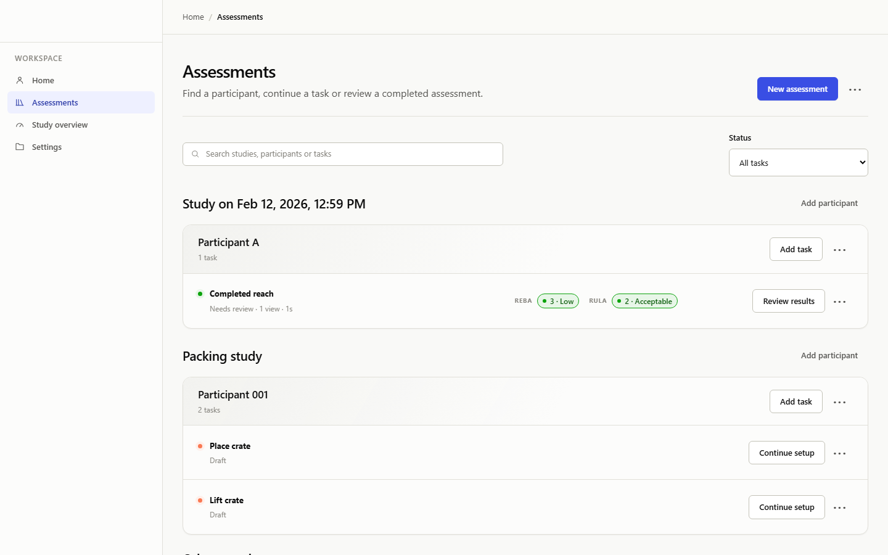

<picture>
  <source media="(prefers-color-scheme: dark)" srcset="brand/ergopartner-horizontal-dark.svg">
  
</picture>

# ErgoPartner 5.1.0

ErgoPartner helps researchers review ergonomic risks in recorded work. Open a task, find the frame behind a posture score, and review the measurements and assumptions before exporting a report. The Human Factors Lab at The University of Texas at Arlington coordinates research evaluation access.

**[Request evaluation access](ACCESS_REQUEST.md)** · [Use policy](USE_POLICY.md) · [Installation and first assessment](INSTALL.md) · [Sample PDF report](examples/synthetic-screening-report.pdf)

## Features

| Workflow | What you can evaluate |
| --- | --- |
| Capture and import | Record a task or import one to three synchronized camera views. Organize recordings by study, participant and named task. |
| Posture screening | Review Rapid Upper Limb Assessment (RULA) and Rapid Entire Body Assessment (REBA) results alongside their supporting frames. Inspect measured inputs, reviewer entries and assumptions. |
| Lifting analysis | Apply the Revised NIOSH Lifting Equation to eligible tasks. Supply load and other required task conditions. The report identifies missing inputs. |
| Local AI review | Select a compatible Ollama vision model for interpretation. Review and save its observations. CPU posture scoring works with Ollama offline. |
| Reporting | Record findings and export a PDF showing scores, available evidence and limitations. |

The screenshot shows synthetic study records. The [sample PDF](examples/synthetic-screening-report.pdf) comes from a separate two-second clip with no person visible. All 14 processed frames lacked a detected pose. The report shows how ErgoPartner communicates insufficient evidence to score a posture.

## First assessment

1. Obtain written approval and download the identified release.
2. Follow the [Windows installation guide](INSTALL.md) to set up Python, the web interface and PDF export. Local AI has its own optional setup.
3. Choose **Analyze recorded video**, create a study and task, and select a recording you have permission to process.
4. Enter the observed task conditions and run analysis. Compare the score with the supporting frame in **Posture review**.
5. In **Findings & report**, save your findings and choose **PDF report**.

## Research evaluation and citation

Approval covers the named evaluators, version and purpose. Repurposing, redistribution, commercial use and production deployment require separate written permission. The team plans an open-source release after further development and finalization. That release will identify its license and the versions it covers. [Evaluation policy](USE_POLICY.md)

For an approved evaluation, cite *ErgoPartner, version 5.1.0* and identify the release tag or commit. Report the recording setup, task conditions, and model tag if you used AI. Interpret scores as ergonomic screening estimates. Their quality depends on camera placement, visibility and the inputs available to the reviewer.

Contact the Human Factors Lab at UTA or Dr. Rahman privately for research questions, access or support. For bugs, include the version, the step that failed and a deidentified error message. [Human Factors Lab](mailto:hflab@uta.edu) · [Dr. Rahman](mailto:mrahman@uta.edu)
