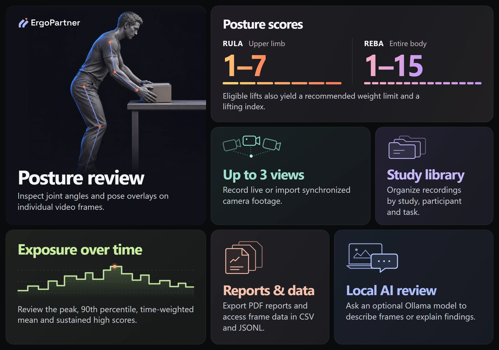

<h1>
  <picture>
    <source media="(prefers-reduced-motion: reduce) and (prefers-color-scheme: dark)" srcset="web/public/brand/ergopartner-horizontal-dark.svg">
    <source media="(prefers-reduced-motion: reduce)" srcset="web/public/brand/ergopartner-horizontal.svg">
    <source media="(prefers-color-scheme: dark)" srcset="web/public/brand/ergopartner-reveal-dark.svg">
    
  </picture>
</h1>

ErgoPartner helps researchers study working posture from video. Record or import a task, find the frame with the highest RULA or REBA score, and inspect the joint angles and task conditions behind it. The Windows application runs locally and supports up to three synchronized views of a task.

**Download and use version 5.1.1 for noncommercial research or evaluation without prior approval.** Repurposing, commercial use and deployment outside that scope require written permission from the research team. [Download the project ZIP](https://github.com/HumanFactorsLab-UTA/ErgoPartner/releases/download/v5.1.1/ErgoPartner-5.1.1.zip) · [Release notes and checksum](https://github.com/HumanFactorsLab-UTA/ErgoPartner/releases/tag/v5.1.1) · [Windows installation](INSTALL.md) · [License](LICENSE) · [Other uses and contact](USE_POLICY.md)

<picture>
  <source media="(max-width: 767px)" srcset="docs/features-mobile.webp">
  
</picture>

## Start your first assessment

1. Install **64-bit Python 3.12.x**, **Node.js 22 or newer with npm**, and **FFmpeg**. Extract the release and follow the PowerShell setup to launch the local dashboard. Core video analysis runs on CPU. Ollama is optional. [Installation and troubleshooting](INSTALL.md)
2. On **Home**, choose **Analyze recorded video** or **Record live**. Select a study, participant and task. For multiple cameras, use synchronized views of the same person and task.
3. Review the load, coupling and other task conditions before running analysis. The default `standing_light_work` profile can supply **0 kg handled load and good coupling**. Replace those assumptions with the observed values when appropriate. [Configuration](config.yaml)
4. Open **Summary** to find the highest scored posture. In **Posture review**, inspect its timestamp, camera evidence and inputs. Save your findings and export a PDF from **Findings & report**.

## How video becomes a score

The default pipeline samples at **10 frames per second**. MediaPipe estimates body landmarks and, when available, hand landmarks. ErgoPartner uses those points to estimate angles such as elbow, wrist, knee, trunk and neck angles. For multiple views, the pipeline checks timestamp alignment and selects or combines eligible angle observations. The landmarks are model estimates. Camera placement, occlusion, and depth error affect the angles. [Pose and camera processing](PROJECT_ARCHITECTURE.md)

Some inputs come from a frame, some from motion over time, and some require a person who knows the task. For posture conditions, a reviewer-entered value takes priority, followed by a measured condition and then a configured assumption. Conditions that still lack a value remain unknown. A load or grip assumption can change the final score even when the footage stays the same. [Input resolution](ergonomics/condition_resolution.py) · [Default profiles](ergonomics/profiles.py)

| Method | Calculation in this release | Output |
| --- | --- | --- |
| **Rapid Upper Limb Assessment (RULA)** | The arm and wrist posture scores enter Table A. Neck, trunk and leg scores enter Table B. The calculator adds muscle-use and force/load adjustments and combines the two adjusted values through Table C. | **1–7**. The action bands are 1–2, 3–4, 5–6 and 7, in order of increasing investigation priority. [RULA implementation](ergonomics/rula.py) |
| **Rapid Entire Body Assessment (REBA)** | Table A combines trunk, neck and legs, with a load/force adjustment. Table B combines upper arm, lower arm and wrist, with a coupling adjustment. Table C combines both groups, then activity adjustments produce the final score. | **1–15**. The bands are negligible (1), low (2–3), medium (4–7), high (8–10) and very high (11–15). [REBA implementation](ergonomics/reba.py) |
| **Revised NIOSH Lifting Equation (RNLE)** | For eligible lifting tasks, the recommended weight limit is **23 kg × HM × VM × DM × AM × FM × CM**. The six multipliers describe horizontal reach, vertical hand position, vertical travel, asymmetry, lifting frequency/duration, and grip quality. | **Recommended Weight Limit (kg)** and **Lifting Index = handled load / recommended weight limit**. An index above 1 means the load exceeds the calculated limit for the stated conditions. [RNLE implementation](ergonomics/niosh.py) · [NIOSH method](https://www.cdc.gov/niosh/ergonomics/about/rnle.html) |

For example, the included REBA worksheet test gives adjusted group scores of **8 and 5**. Table C returns **10**, and one activity point gives **11**, in the very-high band. This example tests the calculation with specified inputs. Agreement with human scoring on video is a separate research question. [Executable worked examples](tests/golden/test_method_golden_cases.py) · [Measurement details and scoring limitations](ERGONOMICS_METHODS.md)

## What the recording summary reports

| Metric | How to read it |
| --- | --- |
| **Peak score, frame and timestamp** | Find the highest scored observation and inspect the footage for that moment. |
| **90th-percentile score** | Describes the upper end of scored observations. An isolated peak and a high 90th percentile can describe different exposures. |
| **Duration-weighted mean** | Weights each score by the time until the next observation of the same person, within the allowed gap. Long gaps contribute no interval. |
| **Sustained high-score periods** | Default thresholds are RULA ≥5 or REBA ≥8 for at least 1 second. A gap over 0.25 seconds breaks a period. |
| **Completion and missing inputs** | Shows how many method observations could be scored and why others were withheld. Read coverage alongside the numeric results. |

The two-second synthetic clip included in the release produced **20 processed frames and zero frames with a detected pose**. Its PDF shows exactly what a reviewer sees when the pipeline cannot issue a posture score. [Sample PDF report](examples/synthetic-screening-report.pdf) · [Summary calculations](temporal/aggregation.py)

## Optional Ollama interpretation

Ollama can describe sampled frames, support a focused visual review and answer questions using the assessment evidence. The Python calculators produce RULA, REBA and RNLE results independently of the language model. Select an installed vision model in **Settings → Local vision model**. Assessment chat also requires tool support. The default endpoint is local at `http://127.0.0.1:11434/v1`.

| Local model | Installed size on the test workstation | Release check |
| --- | --- | --- |
| `gemma4:26b` | About 16.8 GiB on disk | Configured default. Correctly identified the shape and color of both synthetic test images sent through the application. |
| `gemma4:e4b` | About 8.9 GiB on disk | Appeared in the selector but misidentified both images in the same check. |

This two-image check establishes basic image handling on the tested setup. It provides no estimate of ergonomic interpretation accuracy. Disk size also differs from inference memory requirements. [Ollama installation and model setup](INSTALL.md#optional-local-ai-with-ollama)

## Documentation and citation

- [Installation, hardware tested, CLI and troubleshooting](INSTALL.md)
- [Scoring methods, limitations and references](ERGONOMICS_METHODS.md)
- [Source map, files written by an assessment and developer entry points](PROJECT_ARCHITECTURE.md)
- [Study validation tools](validation/README.md) · [Third-party notices](THIRD_PARTY_NOTICES.md)

For publications, identify *ErgoPartner 5.1.1*, the release tag or commit, and any settings or local changes that affect scoring. Report camera setup, sampling rate, supplied task conditions, and the Ollama tag if used. For support or permission beyond noncommercial research and evaluation, contact the Human Factors Lab at The University of Texas at Arlington or Dr. Rahman. [Human Factors Lab](mailto:hflab@uta.edu) · [Dr. Rahman](mailto:mrahman@uta.edu)
